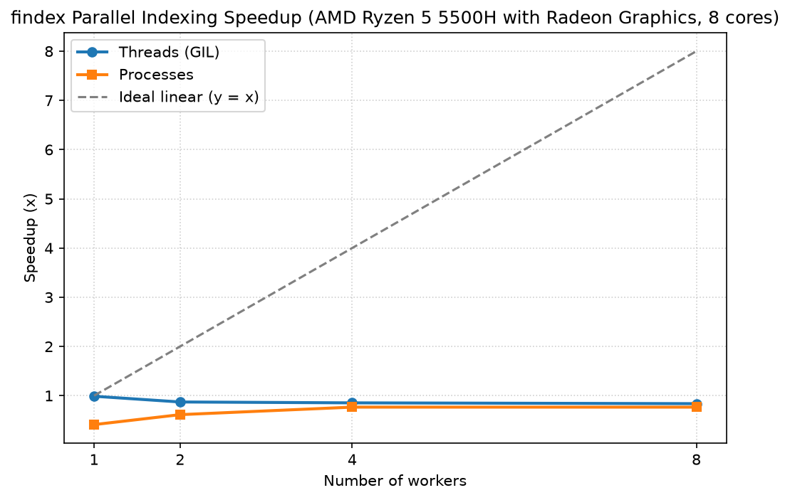

# findex — Пошуковий рушій на Python (Лабораторні роботи 1–3)

Пошуковий рушій з об'єктною моделлю Python (`Index` як `Mapping`), булевим парсером запитів, сніпетами та ранжуванням **TF-IDF** і **BM25**.

## Команди запуску

```bash
# Побудова індексу
python -m src.findex.index data --out index.json

# Пошук зі складним запитом, сніпетами та перевіркою @lru_cache
python -m src.findex.search index.json 'python AND (async OR await) NOT java "event loop"' --scorer bm25 --repeat

# Оцінка якості (3 sanity-check + таблиця Precision@5)
python -m src.findex.evaluate

# Запуск тестів
pytest -v
# findex — Пошуковий рушій на Python

## Команди запуску

```bash
# Побудова індексу (паралельно через процеси за замовчуванням)
uv run findex index data --out index.json --workers 4 --executor processes

# Пошук зі складним запитом, сніпетами та перевіркою @lru_cache
uv run findex search 'python AND (async OR await) NOT java "event loop"' --index index.json --scorer bm25

# Статистика індексу
uv run findex stats --index index.json

# Оцінка якості (3 sanity-check + таблиця Precision@5)
uv run python -m findex.evaluate

# Запуск тестів
uv run pytest -v
```

---

## Лабораторна робота №4: Типи, тести, пакування і CLI

- **Сувора типізація:** `pyright` налаштовано в режимі `strict`, код не містить неанотованих публічних функцій.
- **Тестування:** Написано автотести (`pytest`), включаючи параметризовані тести токенізатора (з підтримкою Unicode), перевірку парсера AST, інваріанти скорерів (TF-IDF та BM25), а також **3 властивості через Hypothesis** (збереження індексу при save/load, сортування постінгів, еквівалентність `merge` та `set`).
- **Пакет і CLI:** Проєкт пакується через `pyproject.toml` (Hatchling) та керується менеджером `uv`. Додано консольний інтерфейс (`typer` + `rich`) з підкомандами `index`, `search` (з таблицею результатів та `--json`), `stats`, а також логуванням у `stderr` і рівнями `-v`/`-vv`.
- **CI/CD:** Налаштовано GitHub Actions (`ci.yml`) на запуск `ruff`, `pyright` та `pytest` з покриттям коду.

---

## Лабораторна робота №5: Конкурентність і GIL — потоки, процеси та паралельна індексація

### Апаратна конфігурація стенду

- **Процесор:** AMD Ryzen 5 5500H with Radeon Graphics
- **Кількість логічних ядер (`os.cpu_count()`):** 8
- **ОС / Python:** Windows 11, CPython 3.14.7 (з GIL) та CPython 3.13.15 free-threaded (`3.13t`, без GIL)
- **Тестовий корпус:** 1200 текстових документів (~9 МБ тексту), сітка воркерів `[1, 2, 4, 8]`, у таблиці наведено **медіану з 3 прогонів** для кожної конфігурації.

### Результати замірів (медіана з 3 прогонів)

| Executor | Workers | Wall time (s) | CPU time (s) | Peak RSS (MB) | Merge (s) | Speedup |
|---|---:|---:|---:|---:|---:|---:|
| `serial` | 1 | 1.2251 | 1.2188 | 115.2 | 0.0117 | 1.00x |
| `threads` | 1 | 1.2394 | 1.2031 | 115.2 | 0.0117 | 0.99x |
| `threads` | 2 | 1.4051 | 0.6719 | 115.2 | 0.0054 | 0.87x |
| `threads` | 4 | 1.4346 | 0.6250 | 115.7 | 0.0062 | 0.85x |
| `threads` | 8 | 1.4620 | 0.5312 | 117.9 | 0.0073 | 0.84x |
| `processes` | 1 | 2.9741 | 0.6562 | 174.8 | 0.0045 | 0.41x |
| `processes` | 2 | 1.9945 | 0.5625 | 174.8 | 0.0052 | 0.61x |
| `processes` | 4 | 1.5972 | 0.5625 | 174.8 | 0.0059 | 0.77x |
| `processes` | 8 | 1.5977 | 0.6719 | 174.8 | 0.0074 | 0.77x |

### Графік прискорення від кількості воркерів



### Експеримент на Python 3.13t (без GIL) та демонстрація гонитви даних

```text
# Стандартна збірка з GIL (CPython 3.14.7)
Python: 3.14.7 | sys._is_gil_enabled() = True
findex threads (4 workers) vs serial: 0.3779s -> 0.5084s (speedup 0.74x)
Unsafe counter (очікувалось 400000): 400000
Safe counter з Lock (очікувалось 400000): 400000

# Free-threaded збірка без GIL (CPython 3.13.15t)
Python: 3.13.15 | sys._is_gil_enabled() = False
findex threads (4 workers) vs serial: 0.5725s -> 0.2996s (speedup 1.91x)
Unsafe counter (очікувалось 400000): 255693
Safe counter з Lock (очікувалось 400000): 400000
```

---

### Аналіз результатів (GIL, процеси, закон Амдала та 3.13t)

1. **Чому потоки під GIL не прискорили індексацію:**
   Побудова індексу (`build_partial`) — це переважно **CPU-bound** задача: регулярні вирази, `casefold()`, підрахунок частот і формування об'єктів `Posting` виконуються в байткоді Python. У стандартному CPython **Global Interpreter Lock (GIL)** дозволяє виконувати байткод лише одному потоку в кожен момент часу. При збільшенні кількості потоків з 1 до 8 час виконання не зменшився, а зріс із `1.2394 с` до `1.4620 с` (`0.84x`) через накладні витрати на перемикання контексту ОС та конкуренцію за захоплення/звільнення GIL.

2. **Як масштабуються процеси та чим це оплачено (CPU time vs Wall time, RSS, spawn/pickle):**
   Кожен процес у `ProcessPoolExecutor` має власний інтерпретатор і власний GIL, тому обчислення реально виконуються паралельно на різних ядрах: при переході від 1 до 4 процесів `wall time` скоротився майже вдвічі (`2.9741 с` → `1.5972 с`). Однак це оплачено трьома ресурсами:
   - **Накладні витрати `spawn` та `pickle`:** на Windows нові процеси створюються методом `spawn` (запуск свіжого інтерпретатора, імпорт модулів) плюс серіалізація великих словників `PartialIndex` з позиціями слів через `pickle` під час передачі результатів у батьківський процес. На невеликих і середніх корпусах фіксована ціна `spawn + pickle` (~1.1 с) помітна на тлі часу токенізації, тоді як на великих корпусах (де обробка триває десятки секунд) `processes` дають стабільний виграш, тому `--executor processes` встановлено типовим у CLI.
   - **CPU time проти Wall time:** `time.process_time()` у таблиці вимірює процесорний час лише **батьківського процесу** (`~0.56–0.67 с` для `processes`, що витрачається на десеріалізацію `pickle` та `merge`), тоді як основна обчислювальна робота розподілена між дочірніми процесами.
   - **Пам'ять (Peak RSS):** пікове споживання пам'яті батьківського процесу зросло зі `115.2 MB` до `174.8 MB` (+60 MB), оскільки в оперативній пам'яті одночасно зберігаються десеріалізовані `PartialIndex` від усіх воркерів до завершення `merge`, а крім цього кожен дочірній процес виділяє власну пам'ять.

3. **Де видно закон Амдала:**
   Згідно із законом Амдала, максимальне прискорення обмежене послідовною часткою роботи $(1 - p)$:
   $$S(N) = \frac{1}{(1 - p) + \frac{p}{N}}$$
   У нашому конвеєрі послідовною частиною є функція **`merge(partials)`** (`0.0045–0.0117 с`), збір результатів `as_completed` та десеріалізація `pickle` у головному процесі. Саме через наявність цієї непаралелізованої ділянки приріст швидкості між `4` і `8` воркерами виходить на плато (`1.5972 с` проти `1.5977 с`), а реальна крива прискорення відхиляється від ідеальної прямої $y = x$.

4. **Що змінилося на збірці Python 3.13t (free-threaded):**
   У збірці `3.13t` (`sys._is_gil_enabled() == False`) інтерпретатор працює без глобального блокування. На тому самому коді `ThreadPoolExecutor` із 4 потоками прискорив індексацію у **`1.91x`** (`0.5725 с` → `0.2996 с`) без витрат на `spawn` процесів і серіалізацію `pickle`. Водночас зникнення GIL оголило класичну **гонитву даних (race condition)**: інкремент спільного лічильника без синхронізації втратив майже 36% оновлень (`255693` замість `400000`), оскільки операція читання-модифікації-запису не є атомарною. Явне блокування через `threading.Lock` повністю відновило інваріант (`400000`). У самому `findex` гонитва при індексації усунута архітектурно: кожен потік працює зі своїм ізольованим діапазоном `doc_id` і повертає власний `PartialIndex`, а об'єднання відбувається в одному потоці на етапі `merge`.